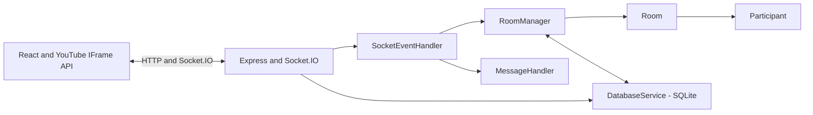

# SyncSpace Watch Party

SyncSpace is a real-time YouTube watch-party application. Create a room, invite people with a six-character code or link, and watch together with server-authoritative playback, role-based controls, chat, and reactions.

- **Live application:** [syncspace-watch-party-0335.onrender.com](https://syncspace-watch-party-0335.onrender.com/)
- **Repository:** [github.com/AyushGupta205/syncspace](https://github.com/AyushGupta205/syncspace)

## Contents

- [Features](#features)
- [Technology](#technology)
- [Architecture](#architecture)
- [Roles and permissions](#roles-and-permissions)
- [Playback synchronization](#playback-synchronization)
- [Socket.IO events](#socketio-events)
- [Storage and session recovery](#storage-and-session-recovery)
- [Security and limits](#security-and-limits)
- [Local development](#local-development)
- [Tests and load checks](#tests-and-load-checks)
- [Operations](#operations)
- [Deployment](#deployment)
- [Future scalability roadmap](#future-scalability-roadmap)
- [Known limitations](#known-limitations)

## Features

- Six-character room codes with collision avoidance and shareable `?room=CODE` links.
- Embedded YouTube playback with native Play/Pause for Hosts and Moderators, plus synchronized SyncSpace playback and timeline controls.
- Participant playback requests for play, pause, seek, or video changes, subject to Host/Moderator approval.
- Host-managed roles, participant removal, and Host transfer.
- Live chat, system messages, and synchronized emoji reactions.
- SQLite persistence and recovery of room/session data.
- Health and aggregate metrics endpoints.

## Technology

- **Frontend:** React 19, Vite 7, and CSS.
- **Backend:** Node.js 22.5+, Express 5, and Socket.IO 4.
- **Persistence:** SQLite through Node's built-in `node:sqlite` API.
- **Tests:** Node's native test runner and Playwright.

## Architecture

The application is a single Node.js server process. Express serves the built Vite client and HTTP endpoints; Socket.IO handles room communication. Room and participant objects are managed in process, with SQLite used for persistence and recovery.



Server modules and responsibilities:

| Module | Responsibility |
|---|---|
| `server/index.js` | Configures Express, Socket.IO, HTTP endpoints, static client delivery, connection limits, and service instances. |
| `server/RoomManager.js` | Creates and looks up rooms, enforces room limits, prunes inactive participants/rooms, and restores persisted rooms. |
| `server/Room.js` | Owns a room's authoritative playback state, revision, participant membership, roles, and host succession. |
| `server/Participant.js` | Represents participant identity, role, socket binding, connection state, and private recovery token. |
| `server/SocketEventHandler.js` | Registers socket events, validates playback actions, enforces server-side permissions, and broadcasts room updates. |
| `server/MessageHandler.js` | Validates chat and reactions and applies message/reaction rate limits. |
| `server/db.js` (`DatabaseService`) | Initializes SQLite and stores/restores room and participant records. |

## Roles and permissions

The server checks the participant associated with the connected socket for every privileged action. Client-side controls are a user-interface affordance, not the authorization boundary.

| Action | Host | Moderator | Participant |
|---|:---:|:---:|:---:|
| Native YouTube Play/Pause (shared) | Yes | Yes | No direct shared control |
| SyncSpace Play/Pause and seek controls | Yes | Yes | No direct control |
| Change video through SyncSpace | Yes | Yes | Request approval |
| Request Play/Pause, seek, or video change | Not needed | Not needed | Yes |
| Approve or reject participant playback requests | Yes | Yes | No |
| Assign/demote moderators | Yes | No | No |
| Transfer Host or remove a participant | Yes | No | No |
| Chat and reactions | Yes | Yes | Yes |

Participants can submit playback requests; only a connected Host or Moderator can approve them. Requests expire after two minutes. Server-side role and payload checks still apply to all direct socket actions.

## Playback synchronization

The room's server state is authoritative. It includes the video ID, play/pause state, timeline, update timestamp, and monotonically increasing revision. While playing, the server derives the current position from its timestamp and broadcasts state changes as `sync_state`.

- **Native Play/Pause:** The YouTube IFrame API reports player state changes but does not conclusively identify whether a callback came from a user or a programmatic command. The client compares actual player state with the latest authoritative state and revision; pending programmatic commands are retained across revisions and video changes so delayed callbacks are reconciled rather than broadcast as new shared commands.
- **Custom Play/Pause and seek:** Native Play/Pause intents and SyncSpace Play/Pause/seek actions (timeline slider and ±10-second buttons) use a client-side serialized queue. Each action is sent to the server, which validates the role and payload, advances the room revision, and broadcasts the resulting state. Native actions additionally carry an expected revision; stale requests are rejected and the latest room state is returned.
- **Video changes:** The SyncSpace video-change action is validated and applied by the server. The room revision advances, and clients load or cue the new video according to the authoritative play state. Changing video preserves whether the room was playing or paused.
- **Stale callbacks and drift:** Player callbacks are reconciled against the latest authoritative state; older server revisions cannot replace newer state, and delayed programmatic callbacks do not create shared playback commands. Clients periodically compare player time with the server timeline and correct drift greater than 1.5 seconds.
- **Native seek:** The implementation does not convert the YouTube seek-bar interaction into a shared seek action. Hosts and Moderators can use the SyncSpace timeline slider or `−10s` / `+10s` controls to seek the room. Periodic reconciliation may move a locally scrubbed YouTube player back toward the room timeline.
- **Role-aware player interaction:** Native controls are enabled (`controls: 1`). Pointer interaction with the iframe is disabled for Participants and enabled for Hosts/Moderators without recreating the player on role changes. The IFrame API is configured with `disablekb: 0`; keyboard shortcuts are not described as disabled. The backend remains authoritative regardless of client-side interaction.

Synchronization is best-effort, not frame-accurate. Network latency, buffering, YouTube player delays, autoplay restrictions, and browser behavior can affect when playback changes appear.

## Socket.IO events

The `playback` event is the unified playback route. The server also accepts the listed `play`, `pause`, `seek`, and `change_video` compatibility events.

| Event | Direction | Purpose |
|---|---|---|
| `create_room` | Client → server | Create a room; creator becomes Host. |
| `join_room` | Client → server | Join an existing room as Participant. |
| `resume_room` | Client → server | Resume a session using its room ID and private session token. |
| `leave_room` | Client → server | Leave a room. |
| `playback` | Client → server | Request `play`, `pause`, `seek`, or `video`; native intents may include `expectedRevision`. |
| `play`, `pause`, `seek`, `change_video` | Client → server | Compatibility aliases for playback actions. |
| `sync_state` | Server → room | Broadcast authoritative playback state and revision, or return the current state after a stale native action. |
| `request_playback_change` | Participant → server | Submit a playback request for approval. |
| `playback_change_requested` | Server → Host/Moderators | Notify approvers of a pending request. |
| `resolve_playback_request` | Host/Moderator → server | Approve or reject a pending request. |
| `playback_request_resolved`, `playback_request_result`, `pending_playback_requests` | Server → clients | Update approver queues and report a request result to its requester. |
| `assign_role`, `transfer_host`, `remove_participant` | Client → server | Host-only room-management actions. |
| `participants_updated`, `user_joined`, `user_left`, `participant_disconnected`, `role_assigned`, `participant_removed`, `host_changed`, `removed_from_room` | Server → clients | Report membership, role, removal, and Host changes. |
| `chat` | Client → server | Submit a chat message. |
| `chat_message`, `chat_rate_limited` | Server → clients | Broadcast a message or report chat throttling. |
| `reaction` | Client → server; server → room | Submit and broadcast an allowed emoji reaction. |
| `action_rejected` | Server → client | Report a rejected action or authorization/validation error. |

## Storage and session recovery

`server/db.js` creates two SQLite tables:

- **`rooms`** stores room ID, video ID, current time, play state, and creation/update timestamps.
- **`participants`** stores participant ID, room ID, username, role, private session token, join order, and connection status.

Set `DB_PATH` to choose the SQLite file; the default is `data/syncspace.db`. SQLite uses write-ahead logging, a busy timeout, foreign keys, and an index for room participant ordering. The startup schema setup includes an idempotent migration for participant join-order data.

Recovery tokens are stored in browser `sessionStorage` and are not included in public participant data. A reconnect can resume the same participant session within the 15-minute grace period. If a session is resumed from a replacement socket, the previous socket is disconnected. Persisted rooms are restored at server startup when SQLite is available. The process-local in-memory fallback is for non-production environments only; production health checks report unavailable/degraded persistence.

## Security and limits

- Server-side checks enforce Host/Moderator playback permissions, Host-only room management, participant membership, and input validation.
- Video IDs, playback times, usernames, chat text, and reaction emoji are validated. Chat is rendered as React text rather than injected HTML.
- Session tokens are generated with `node:crypto` and kept out of public room payloads.
- Defaults include limits of 500 rooms, 100 participants per room, 5,000 connections, and 100 connections per address. These can be configured with environment variables.
- Room creation is limited to 10 attempts per minute per peer address; joining is limited to 20 per minute. Per-socket limits include 20 playback actions per 2 seconds, 3 playback requests per minute, 10 room-management actions per 2 seconds, 10 reactions per 2 seconds, and 5 chat messages per 2 seconds.
- Production Socket.IO/browser origins default to same-origin; configure `CLIENT_ORIGIN` only when separate allowed origins are needed. JSON bodies are limited to 16 KB.
- HTTP responses include `X-Content-Type-Options`, `Referrer-Policy`, and `Permissions-Policy` headers.

These controls reduce abuse but do not constitute a general guarantee against denial-of-service or other attacks; deploy behind appropriately configured infrastructure.

## Local development

### Prerequisites

Install Node.js 22.5 or newer (required for the built-in `node:sqlite` API).

### Install and run

```bash
git clone https://github.com/AyushGupta205/syncspace.git
cd syncspace
npm ci
npm run dev
```

Vite serves the frontend at `http://localhost:5173`; the Express and Socket.IO server listens at `http://localhost:3005`.

To build and run the production server locally:

```bash
npm run build
npm start
```

The server serves the built client on its configured `PORT` (3005 by default).

### Docker

```bash
docker build -t syncspace-watch-party .
docker run --rm -p 3005:3005 -v syncspace-data:/data syncspace-watch-party
```

The image uses Node 22, runs as a non-root user, and includes an HTTP health check. Mount `/data` on durable storage if the SQLite database must survive container replacement.

## Tests and load checks

Run the project checks with:

```bash
npm test
npm run build
npm run test:e2e
npm run load-test -- 100
```

- **Unit/integration tests (`npm test`):** Node's test runner covers server/socket behavior, persistence and recovery, role enforcement, playback revisions, validation, and URL parsing.
- **Browser E2E (`npm run test:e2e`):** Playwright starts isolated server/client processes and mocks the YouTube IFrame API. These tests cover browser flows such as roles, requests, playback synchronization, video changes, and session recovery; they do not prove behavior against YouTube's real player.
- **Load check (`npm run load-test -- 100`):** Simulates the requested number of Socket.IO participants (1–1,000) against a local in-memory server and reports join and playback-broadcast latency. Results are not production capacity guarantees.
- **Real-browser playback and verification distinctions:**
  - **Render deployment and asset delivery:** Confirmed live on Render serving `index-C2KG0g2Y.js` and `index-DKSWS5LP.css` built from commit `8c015fee3df78806e57db755f299b537b7ecccdf`.
  - **Two-session room creation, joining, and permissions:** Confirmed in automated tests and live sessions. Creators become Host; joiners default to Participant. Server-side RBAC enforces that only Hosts and Moderators control playback directly, while Participants must submit playback requests for Host/Moderator approval.
  - **Application-state synchronization:** Confirmed at the application layer across sessions for room status: shared Play/Pause state, monotonically increasing revisions, video changes preserving play/pause state, and request approval workflows.
  - **Shared seeking through SyncSpace timeline slider:** Confirmed in automated E2E tests (`e2e/room-sync.spec.js`), verifying slider scrubbing and ±10-second button adjustments update the room timeline and broadcast server-validated revisions.
  - **Actual YouTube media playback in real browsers (REMAINS UNVERIFIED):** In the previous real-browser attempt on Chrome 150, the third-party iframe loaded the selected video title, but the HTML5 player reported `html5.missingapi` / `nocodecs.1`; actual video decoding, audio rendering, and native media playback could not be verified. Room membership, UI updates, and synchronized status do not constitute proof of actual media playback. Automated Playwright E2E tests mock the YouTube IFrame API for deterministic CI and do not connect to real YouTube video streams. Conclusive synchronized media playback in a real browser environment with working native video codecs remains explicitly unverified.

Latest validation in this audit: `npm ci` completed with no reported dependency vulnerabilities; `npm test` passed 14/14; `npm run build` passed; `npm run test:e2e` passed 8/8; `npm run load-test -- 100` joined all 100 simulated clients; and `git diff --check` passed. The E2E suite mocks the YouTube IFrame API. Real-browser native media playback remains unverified.

The GitHub Actions workflow runs dependency installation, Playwright browser installation, unit/integration tests, E2E tests, a 250-client load check, and the production build on pushes and pull requests.

## Operations

| Endpoint | Behavior |
|---|---|
| `GET /api/health` | Reports health, persistence status, active rooms/connections, uptime, and timestamp. In production, unavailable or degraded persistence returns HTTP 503. |
| `GET /api/metrics` | Returns aggregate process counters. In production, the route is unavailable unless `METRICS_TOKEN` is configured; when configured, send `Authorization: Bearer <METRICS_TOKEN>`. |

The metrics endpoint does not include room or participant identifiers. Server lifecycle and SQLite failures are emitted as structured JSON log events.

Optional environment settings are listed in [.env.example](./.env.example). Notable settings include `PORT`, `NODE_ENV`, `DB_PATH`, `CLIENT_ORIGIN`, `TRUST_PROXY`, `MAX_ROOMS`, `MAX_PARTICIPANTS_PER_ROOM`, `MAX_CONNECTIONS`, `MAX_CONNECTIONS_PER_IP`, and `METRICS_TOKEN`. `TRUST_PROXY` should only be enabled when a trusted proxy overwrites forwarded client addresses.

## Deployment

SyncSpace requires a long-running Node.js web service for Socket.IO. The repository's Render configuration is in [`render.yaml`](./render.yaml):

- Runtime: Node; `NODE_VERSION=22`.
- Build: `npm ci --include=dev && npm run build`.
- Start: `npm start`.
- Health check: `/api/health`.
- `DB_PATH` is set to `data/syncspace.db`; `CLIENT_ORIGIN` is available for configuration.

The current live application is [https://syncspace-watch-party-0335.onrender.com/](https://syncspace-watch-party-0335.onrender.com/).

### Confirmed deployment status

- **Platform:** Render
- **Status:** Deploy succeeded — Live
- **Verified commit:** `8c015fee3df78806e57db755f299b537b7ecccdf`
- **Frontend JavaScript asset:** `index-C2KG0g2Y.js`
- **Frontend CSS asset:** `index-DKSWS5LP.css`
- **Production build:** Completed successfully (`npm ci --include=dev && npm run build`)
- **Health check:** Verified at `/api/health` returning HTTP 200 (`ok: true`, `persistence: "sqlite"`, `persistenceDegraded: false`).

**Render Free-tier note:** Free web services may spin down after inactivity and have cold starts. Their filesystem is ephemeral, so SQLite data can be lost when the service restarts, sleeps, or is redeployed. Use durable storage or an external database when room/session persistence across such events is required.

Other deployments need Node.js 22.5+, the same `npm start` command, a writable SQLite path (or suitable storage), and correct proxy/origin configuration. The Docker image defaults to `/data/syncspace.db`.

## Future scalability roadmap

The current application is single-instance: room ownership and live room state are held in one process, with SQLite persistence. Redis is **not** currently deployed. Horizontal scaling would require both cross-instance Socket.IO event fanout (for example, a Redis adapter) and shared, coordinated room/session state; adding a Socket.IO adapter alone would not be sufficient. Polling-based deployments also need suitable load-balancer affinity.

The local load-test script can help compare changes in a controlled environment; its output is machine-specific and is not a Render or multi-instance capacity measurement.

## Known limitations

- YouTube videos may disallow embedding or playback in an iframe (including errors 101/150), be unavailable, or require browser/user action.
- Autoplay can be blocked by browser policy; synchronization cannot force playback when the browser requires a user gesture.
- Native YouTube Play/Pause state changes can be observed, but the IFrame API does not conclusively identify whether a callback was user-generated or programmatic. The client reconciles callbacks against authoritative room state and revision; this is best-effort arbitration.
- Native YouTube seek-bar gestures are not submitted as shared seek commands. Hosts and Moderators should use the SyncSpace timeline slider or seek buttons for synchronized seeking.
- Playback synchronization is not frame-accurate and depends on network, buffering, and player latency.
- The server is single-instance today. Render Free-tier SQLite storage is ephemeral; use durable storage for persistence across service restarts.
